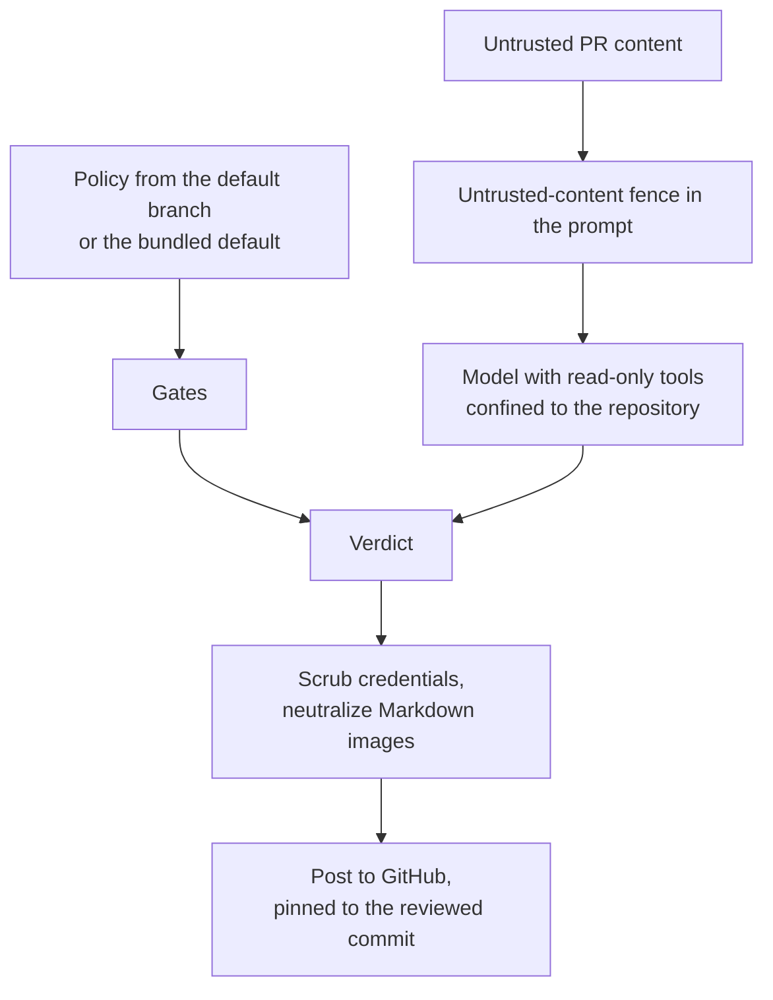

stamp runs an LLM over untrusted PR content, so it trusts nothing the PR ships.

- stamp reads policy from the default branch or the bundled default, never from the checkout.
- The reviewer's tools are read-only and confined to the repository, symlinks included.
- Hooks, MCP config, `CLAUDE.md`, `AGENTS.md` and `.codex/` in the checkout are content, not configuration, on every backend.
- stamp scrubs posted bodies and neutralizes Markdown images.
- A supersession protocol governs approvals: no approval survives a re-review, a retarget, a newer run's verdict, or a push that changes the PR's diff. A push that leaves the diff byte-identical keeps it only through [approval retention](/stamp/operations/approval-retention/).
- A verdict alert goes out only after the posted verdict is confirmed current, and a failing webhook never changes a verdict.
- stamp auto-approves only people who could merge anyway.

[AGENTS.md](https://github.com/jagreehal/stamp/blob/main/AGENTS.md) holds the details and invariants.
