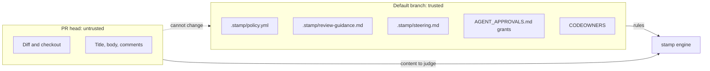
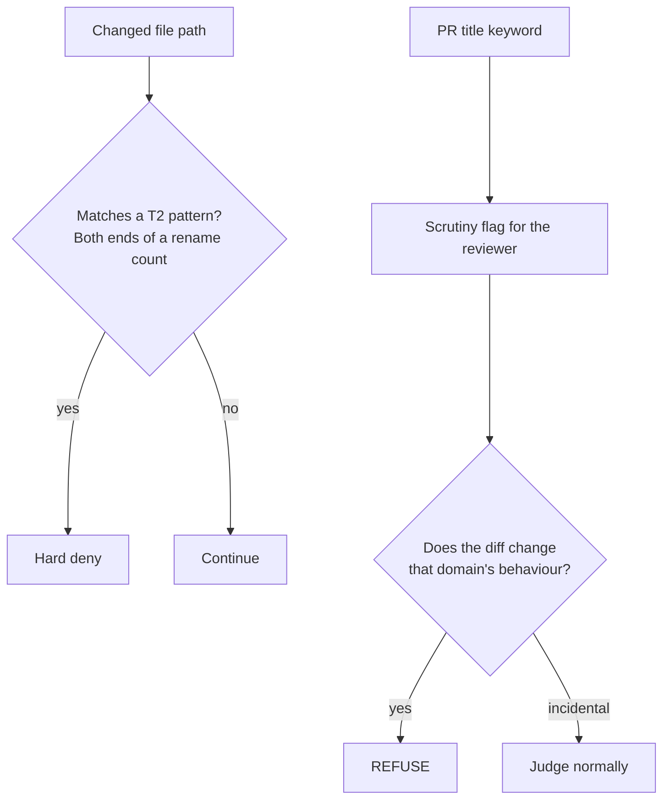

Customization is optional. A repository with no `.stamp/` directory reviews under the bundled defaults in [`.stamp/`](https://github.com/jagreehal/stamp/blob/main/.stamp/).



stamp reads the `.stamp/` files from the repository's **default branch**, never from the PR head, so a PR cannot rewrite the policy that gates it. When the default branch has no such file, stamp uses the bundled default, however many `.stamp/` files the PR adds.

| File                 | Required | Default when absent      | How it combines with the default                 |
| -------------------- | -------- | ------------------------ | ------------------------------------------------ |
| `policy.yml`         | No       | The bundled policy       | Replaces the bundled policy                      |
| `review-guidance.md` | No       | The bundled norms        | Replaces the bundled prose                       |
| `steering.md`        | No       | Nothing added            | Appended under "Repository-specific steering"    |

Folder `AGENT_APPROVALS.md` files, in any directory, raise size ceilings within `overrides:`. They live outside `.stamp/`, and stamp still deny-lists them and reads them from the default branch only.

The deny-list covers every edit to these files (`stamp_policy`), so the gate cannot approve changes to itself. The same category covers `CODEOWNERS`, a gate input, and `stamp/src/` for a repository that vendors the engine.

## Tiers

| Tier             | Lines | Files | Meaning                                    |
| ---------------- | ----- | ----- | ------------------------------------------ |
| T0-deterministic | –     | –     | Docs, tests, config only. Lighter bar.     |
| T1a-trivial      | ≤20   | ≤3    |                                            |
| T1b-small        | ≤100  | ≤5    |                                            |
| T1c-medium       | ≤300  | ≤15   |                                            |
| T1d-complex      | more  | more  | Full read, still under the ceiling.        |
| T2-never         | –     | –     | Matches a `deny` category. A human, always. |

Size sets how hard the reviewer looks. It never sets risk on its own. stamp can approve a large, well-tested refactor, and under a strict policy it sends a five-line billing change to a human.

## Deny and scrutiny categories

A changed file that matches a `deny` category sends the PR to a human before the model runs. The bundled policy denies one category, `stamp_policy`, and flags the sensitive areas below under `scrutiny`: the reviewer reads those changes with a category-specific instruction and can approve, refuse or escalate. `stamp init --strict` writes a policy that denies all of them instead ([strict starting policy](/stamp/configuration/examples/#strict-starting-policy)).

| Category           | Patterns                                                                                    | Bundled policy | `--strict` |
| ------------------ | ------------------------------------------------------------------------------------------- | -------------- | ---------- |
| **auth**           | auth, login, signup, oauth, saml, sso, oidc, credential, password, 2fa, mfa, permission, …   | scrutiny       | deny       |
| **crypto_secrets** | crypto, encrypt, decrypt, vault, secret, api_key, private_key, certificate, `.env`, `.pem`   | scrutiny       | deny       |
| **migrations**     | `migrations/`, `drizzle/`, `prisma/migrations`, schema_change                               | scrutiny       | deny       |
| **infra_cicd**     | terraform, kubernetes, helm, k8s, dockerfile, `.github/workflows`, iam, cloudflare, `deploy.sh`, `vercel.json`, `fly.toml` | scrutiny | deny |
| **billing**        | billing, payment, stripe, invoice, pricing                                                  | scrutiny       | deny       |
| **public_api**     | openapi, api_schema, swagger, public_api                                                    | scrutiny       | deny       |
| **deps_toolchain** | lockfiles, `requirements*.txt`, Makefile, `.nvmrc`, `.tool-versions`                        | scrutiny       | deny       |
| **stamp_policy**   | `.stamp/`, `stamp/src/`, CODEOWNERS, `AGENT_APPROVALS.md`, stamp's workflows (`stamp.yml`, `stamp-edited.yml`, `stamp-digest.yml`, `stamp-actions.yml`: their variables override the policy), a configured rule pack's file and every file in its directory (the reference files its rules link), shepherd's config and local packs with `rules_from` or a bare model name (a possible tier) | deny | deny |



Only file paths hard-deny. A rename counts on both paths, so moving a file out of `auth/` changes `auth/`.

PR-title keywords never deny on their own. They reach the reviewer as scrutiny flags to verify against the diff: REFUSE when the change touches the flagged domain's behaviour, judge normally when the mention is incidental. A calibration against ~440 deny-listed PRs set that split: humans approved most title-only hits unchanged.

Word patterns match on boundaries that also break on `_` and `-`, so `secret` matches `secret_key.ts` and skips `nosecrets.ts`, and `auth` skips `author.ts`. A pattern containing `/` or starting with a dot matches as a path fragment.

Dependency _manifests_ (`package.json`, `pyproject.toml`, `Cargo.toml`, `go.mod`, `Gemfile`, `tsconfig*.json`) don't hard-deny either. Without a lockfile change they can't pull in third-party code, because CI installs from a frozen lockfile.

Two guards cover manifest scripts or hooks that execute in CI:

- A deterministic scan compares `scripts`, `husky`, `lint-staged`, `pnpm` and `simple-git-hooks` between base and head as parsed JSON. Editing an existing script's command never mentions `scripts` on the changed line, so a line diff would miss it. Any difference hard-denies, and so does a manifest that fails to parse.
- The reviewer prompt tells the model to REFUSE execution-bearing changes the scan can't name.

stamp keeps manifest PRs out of the T0 fast path.

### Advice on a denied PR

A denial skips the model by default, so the person it hands over to sees which gate fired, not what is wrong with the change. Set `advise_on_deny: true` (or `STAMP_ADVISE_ON_DENY=true`) and stamp still asks the reviewer model, then appends its findings to the refusal under **Advisory review (cannot approve)**. The verdict stays REFUSED whatever the model says, an approval included. The run's budget, guard and timeout apply, so it costs one review per denied PR; a failed advisory call refuses without it. A PR that fails the base, secrets or prerequisites gate gets no advice: the model would judge other people's commits, send a credential to the provider, or read an outsider's checkout.

## Scrutiny paths

`scrutiny:` in `policy.yml` names files that never deny on their own. stamp reports them to the reviewer with what would make the change a refusal.

The shipped `quality_gates` group covers lint, type-check, test and coverage configuration: `.oxlintrc`, `eslint.config`, `biome.json`, `vitest.config`, `codecov`, `.pre-commit-config`, `.husky/`, scanner settings such as `.semgrepignore`, `.gitleaks.toml` and `.golangci`, and the rest of that list. The reviewer must REFUSE a disabled or downgraded rule, a widened ignore, a lowered coverage threshold, a strict flag turned off, a removed hook, or an excluded scanner rule or path. It approves tightening. A `skip` or `only` added to a test never reaches the reviewer: the `tests` gate holds it first.

Agents loosen these files to reach green, and a linter cannot see its own config change. A path deny would refuse a tightened rule along with a loosened one, so the reviewer judges the diff.

stamp also scans added lines for suppression comments: `eslint-disable`, `oxlint-disable`, `biome-ignore`, `@ts-ignore`, `@ts-expect-error`, `noqa`, `nosec`, `nosemgrep`, `nolint`, `type: ignore`, coverage ignores and their kin. Each one reaches the reviewer as a `suppressions` scrutiny flag naming the file and the kind. The reviewer reads the code each one covers, refuses a suppression that hides a finding the change introduces, and approves a narrow one with its reason. Like any scrutiny flag, it also brings in the second reviewer when one is configured.

A PR that closes an issue labelled `incident` (a failure seen on the default branch or in production, often opened by shepherd's `incident` skill) gets an `incident` scrutiny flag. The reviewer refuses it unless a test reproduces the reported failure (one the diff adds, or for a red default branch the test already failing there), and refuses a fix that hides the symptom: an error swallowed, a retry or timeout raised around it, the alert removed, the test skipped.

The shipped `review_agents` group covers what review and fix agents follow on later PRs: `.shepherd/`, `.claude/skills/`, `.agents/skills/`, `AGENTS.md`, `CLAUDE.md`, `REVIEW.md` (Claude Code Review's instructions) and `docs/adr/`. The reviewer must REFUSE a removed lens, a narrowed `applies_to`, a deleted or weakened rule, loosened Fix guidance or a relaxed house rule. It approves additions and tightening.

## Team rules

Read [Team rules](/stamp/configuration/rule-packs/). With `rules_from.shepherd`, stamp builds rule packs from shepherd's lenses, so a team declares them once.

## Size ceiling

Over 800 substantive lines or 30 substantive files, a PR is too large for auto-review.

Docs, snapshots, images, lockfiles and tests don't count toward the ceiling: they inflate diffs without adding review surface. They still count toward tier classification, and the reviewer still reads them.

90 days of denial outcomes set the limits. Denied PRs that merged unchanged cluster at 500–750 substantive lines, and past ~800 the merged-unchanged rate collapses, so stamp escalates there.

Per-folder grants raise those limits within the `overrides:` ceilings in `policy.yml` (defaults 1000 lines / 50 files). Put an `AGENT_APPROVALS.md` on an ancestor of the changed files:

```yaml
---
stamp:
  size_gate:
    max_files: 40
    max_lines: 900
---
```

stamp reads grants from the **default branch** only, the same trust boundary as policy. It ignores a file with invalid frontmatter. The nearest valid grant wins per key, and a roof (the most generous ceiling in play) still bounds the whole PR. The deny-list covers edits to `AGENT_APPROVALS.md`.

## Author familiarity

Read [Author familiarity](/stamp/configuration/author-context/).

## Test evidence

Read [Test evidence](/stamp/guides/test-evidence/).

## Approval retention

Read [Approval retention](/stamp/operations/approval-retention/).

## Slack digest

Read [Slack digest](/stamp/integrations/notifications/).

## Notifications

Read [Notifications](/stamp/integrations/notifications/).

## Branding

`branding` changes how posted reviews look. Leave it out and reviews look exactly as they always have.

```yaml
branding:
  name: Acme Review                        # the header reads "## ❌ Acme Review: REFUSED"
  avatar: https://acme.example/logo.png    # optional; 20×20 at the start of the header
  emoji:                                   # any subset; the rest keep their defaults
    ESCALATE: ⚠️
    pass: 🟢
```

The keys are every glyph stamp posts: `APPROVED` ✅, `REFUSED` ❌, `ESCALATE` 🙋, `ERROR` ⚠️, `pass` ✓ and `fail` ✗ (the gate table and the console), and `fix` 🤖 (the "Fix with a coding agent" summary). The merge-risk glyphs (🟢 🟡 🔴) are fixed. `avatar` must be an `https://` URL. stamp escapes `name`, `avatar` and every glyph, so a policy value can't add markup. A glyph is at most 16 characters with no whitespace.

Stamp finds its own earlier reviews through the hidden `<!-- stamp-run:… -->` and `<!-- stamp-reviewed:… -->` markers, never the header, so branding doesn't affect retraction or approval retention. Tools that look for stamp's review should match `<!-- stamp-run:` too, not the heading text.

The profile picture beside each review is the account that posts it, not anything in the review body. With the workflow's `github.token`, that's `github-actions[bot]`. To show your own logo there, post as a GitHub App: create an app with your logo as its avatar, install it on the repository with pull request read and write, mint a token in the workflow (for example with `actions/create-github-app-token`), and pass it to stamp as `GH_TOKEN`, with `STAMP_BOT_LOGIN` set to `<app-slug>[bot]`. stamp recognises its reviews from any `[bot]` account by their run marker, and its card's checkboxes the same way: `stamp.yml` and `stamp-actions.yml` act on a card posted by any `[bot]` account, once they have checked that whoever ticked the box can merge.
