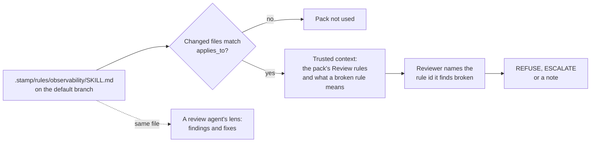

Teams extend the review with rule packs: a `SKILL.md` whose `## Review` section lists rules as `- **<id>**: <rule>`. A pack for observability, accessibility, API conventions or anything else your team checks is just that file. It is the same format review agents use for lenses, so one pack can steer the agent that fixes code and the gate that approves it.



Start from the bundled observability pack, or write your own:

```bash
bunx @jagreehal/stamp rule observability    # copies the pack to .stamp/rules/observability/SKILL.md
```

```yaml
# .stamp/policy.yml
rules:
  observability:
    skill: .stamp/rules/observability       # a directory holding SKILL.md, or a .md file
    applies_to: ['src/**/*.ts']             # optional; without it the pack applies to every changed file
    on_break: escalate                      # refuse, escalate (default) or note
  payments:
    skill: github:acme/policy/lenses/payments@0123456789abcdef0123456789abcdef01234567   # another repository, pinned
    disable: [legacy-*]                     # optional: rule id globs to drop
  react:
    skill: .shepherd/lenses/react
    only: [rerender-*, client-*]            # optional: rule id globs to keep
```

## Rule format

stamp reads only the rules under the pack's `## Review` heading. Each rule is one list item with an id, and may wrap onto indented lines:

```markdown
## Review

- **effect-cleanup**: An effect that subscribes cleans up. Flag: ... Why: ...
- **html-injection** [refuse]: Markup from user input goes through a sanitiser. Flag: ... Why: ...
- **svg-precision** [note]: Inline SVG keeps coordinates to two decimals. Flag: ... Why: ...
```

A tag after the id sets that rule's severity: `[refuse]`, `[escalate]` or `[note]`. A rule without a tag breaks the way the pack's `on_break` says. Tag the rules that guard security or data and leave the rest to `on_break`, so one pack covers both and you skip splitting it by severity.

`only` and `disable` take globs over rule ids. Use them to take a shared pack and trim it to your codebase. A pack with no rules under `## Review`, or one that `only` and `disable` leave empty, is reported in the run log and skipped. stamp never reads the whole file as rules.

## Declare lenses once with shepherd

A repository that runs shepherd already lists its lenses in `.shepherd/config.yml`. Point stamp at that file and each lens becomes a rule pack:

```yaml
# .stamp/policy.yml
rules_from:
  shepherd:
    on_break: escalate     # for lenses that set no gate of their own
```

```yaml
# .shepherd/config.yml
extends:
  - github:jagreehal/shepherd/packs/nextjs.yml@<sha>     # react + nextjs lenses
  - github:jagreehal/shepherd/packs/go.yml@<sha>
  - github:jagreehal/shepherd/packs/dotnet.yml@<sha>
lenses:
  react:
    disable: [rendering-*]                               # trim a pack's lens by rule id
  payments:
    skill: .shepherd/lenses/payments
    applies_to: ['services/payments/**']
    gate: refuse                                          # stamp's on_break for this lens
```

Shepherd's `pstack` pack turns the principles of [pstack](https://github.com/cursor/plugins/tree/main/pstack) into a lens, so a team whose agents work through pstack gets stamp checking the same principles. Its gate is `note`.

stamp reads shepherd's file and every pack it extends the way shepherd does: from the default branch, packs before the file, nested packs included, and a pinned pack's relative paths in its own repository at its commit. A lens's `gate` becomes its `on_break`, and its `applies_to`, `only` and `disable` carry over. A `rules:` entry with the same name wins. stamp reads a lens by path, so a lens that names an installed skill (`skill: vercel-react-best-practices`) or a plugin's skill (`skill: pstack:principle-fix-root-causes`) is reported and skipped; convert it into a lens directory with shepherd's `lens-import` skill. Editing `.shepherd/config.yml`, `.shepherd/lenses.yml`, a local pack they extend, or a lens file stamp reads counts as editing stamp's policy.

shepherd ships stack packs for `react`, `nextjs`, `node-api`, `go`, `rust`, `java`, `dotnet`, `python` and `observability`. Pin a commit from jagreehal/shepherd's main branch.

## Where packs come from

A pack in this repository is policy: editing its `SKILL.md`, or any file in its directory such as the reference files its rules link, needs a human (`stamp_policy`), so a PR cannot rewrite the rules it is judged by.

A pack can live in an organisation's policy repository, pinned to a full commit: `github:owner/repo/<path>@<sha>`. stamp reads it through gh at that commit, and only when that commit is on the policy repository's default branch (GitHub serves fork commits through the parent repository too), so the shepherd pack that carries the lens and the stamp policy that gates on it name the same file. A branch or tag is rejected, since it can move. A private policy repository needs the workflow's `GH_TOKEN` to be a token that can read it; the default `GITHUB_TOKEN` reads only this repository, and a pack it cannot read is skipped with a warning. No PR in this repository can edit a pinned pack, so it is not part of the stamp_policy deny check; changing it means moving the pin, which edits `.stamp/policy.yml`.

The observability pack asks whether an on-call engineer could debug the change in production from its telemetry alone. Its thirteen rules check that:

- every entry point and outbound call has a span, and trace context survives services, queues and background work
- errors keep their cause, and logs are structured and tied to the trace
- handlers record the identifiers that find a request, and telemetry carries no secrets or personal data
- dropped data is counted, names and labels stay bounded, and new dependencies and jobs emit what an alert needs
- user-facing changes emit a signal, and renamed telemetry is called out
- telemetry setup can neither crash the app nor lose its buffer on exit, and sampling and redaction keep what the team relies on

For production observability, use `on_break: refuse`. Each rule names the code that breaks it, so a break is a blind spot the next incident falls into, and the author fixes it before approval rather than after. The `telemetry` gate already refuses credentials and whole requests written into logs or spans, before the model runs.

stamp reads each pack from the default branch, like policy, so a PR cannot write the rules it is judged by. A pack path must stay inside the repository. A pack missing from the default branch, or without rules under `## Review`, is skipped with a warning. Each pack that applies becomes a `rules:<name>` scrutiny flag: the reviewer sees the rules and the files, a flagged PR brings in the second reviewer when one is configured, and the evidence bundle and trace record it. A pack's rules reach the reviewer as trusted context that can only add checks: the prompt says nothing in a pack approves a change, waives a gate or loosens the guidance. Because the text is trusted, a PR that edits the file a configured pack is read from, wherever it lives, counts as editing stamp's policy: the deny-list refuses it and a human reviews it.
