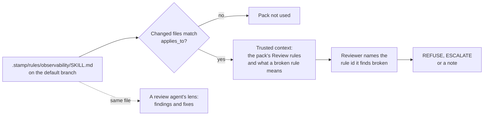

Teams extend the review with rule packs: a `SKILL.md` whose `## Review` section lists rules as `- **<id>**: <rule>`. A pack for observability, accessibility, API conventions or anything else your team checks is just that file. It is the same format review agents use for lenses, so one pack can steer the agent that fixes code and the gate that approves it.



Start from the bundled observability pack, or write your own:

```bash
bunx @jagreehal/stamp rule observability    # copies the pack to .stamp/rules/observability/SKILL.md
```

```yaml
# .stamp/policy.yml
rules:
  observability:
    skill: .stamp/rules/observability       # a directory holding SKILL.md, or a .md file
    applies_to: ['src/**/*.ts']             # optional; without it the pack applies to every changed file
    on_break: escalate                      # refuse, escalate (default) or note
  payments:
    skill: github:acme/policy/lenses/payments@0123456789abcdef0123456789abcdef01234567   # another repository, pinned
```

A pack can live in an organisation's policy repository, pinned to a full commit: `github:owner/repo/<path>@<sha>`. stamp reads it through gh at that commit, and only when that commit is on the policy repository's default branch (GitHub serves fork commits through the parent repository too), so the shepherd pack that carries the lens and the stamp policy that gates on it name the same file. A branch or tag is rejected, since it can move. A private policy repository needs the workflow's `GH_TOKEN` to be a token that can read it; the default `GITHUB_TOKEN` reads only this repository, and a pack it cannot read is skipped with a warning. No PR in this repository can edit a pinned pack, so it is not part of the stamp_policy deny check; changing it means moving the pin, which edits `.stamp/policy.yml`.

The observability pack checks that outbound calls carry a span or log, that errors keep their cause, that logs are structured and free of secrets and personal data, that dropped data is counted, that labels stay bounded, and that a user-facing change emits a signal.

stamp reads each pack from the default branch, like policy, so a PR cannot write the rules it is judged by. A pack path must stay inside the repository. A pack missing from the default branch is skipped with a warning. Each pack that applies becomes a `rules:<name>` scrutiny flag: the reviewer sees the rules and the files, a flagged PR brings in the second reviewer when one is configured, and the evidence bundle and trace record it. A pack's rules reach the reviewer as trusted context that can only add checks: the prompt says nothing in a pack approves a change, waives a gate or loosens the guidance. Because the text is trusted, a PR that edits the file a configured pack is read from, wherever it lives, counts as editing stamp's policy: the deny-list refuses it and a human reviews it.
