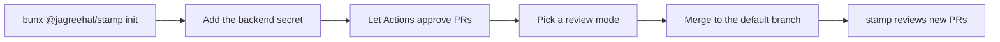

1. From the repository you want reviewed, run `bunx @jagreehal/stamp init`. It writes `.stamp/policy.yml`, `.stamp/review-guidance.md`, `.github/workflows/stamp.yml`, `.github/workflows/stamp-edited.yml` and `.github/workflows/stamp-digest.yml`. It never overwrites a file that exists.
2. Add the secret for your backend: your model provider's key as `STAMP_API_KEY` (see [Backends](/stamp/reference/backends/)) with `STAMP_MODEL` as a repository variable, or `CLAUDE_CODE_OAUTH_TOKEN` (from `claude setup-token`) with the `STAMP_BACKEND` variable set to `claude`. Put settings such as `STAMP_MODEL` and `STAMP_BACKEND` in variables, never secrets: GitHub masks a secret's value throughout the logs.
3. In Settings → Actions → General, turn on **Allow GitHub Actions to create and approve pull requests**. Without it stamp still posts the approval, but the approval does not satisfy a required-reviews rule.
4. Pick a **review mode**. Leave `STAMP_LABEL` unset to review every PR. Set `STAMP_LABEL: stamp` in the workflow env to review only PRs with that label.
5. Merge. stamp reads policy from the default branch, so it applies once it lands.

The workflow runs on open, push, reopen, ready-for-review, convert-to-draft, label and unlabel, and on a `/stamp` comment from an owner, member or collaborator. `stamp-edited.yml` calls it on a base retarget, or when the author edits the review agent's disclosure section into the body, so other description edits add no `stamp / review` run.

The workflow pins the engine version, and pins `oven-sh/setup-bun` to a commit SHA because the job holds model keys. The engine decides what gets approved, so a version bump should arrive as its own PR.

Start with one repository, all-PRs mode, and a spend cap on the key.
