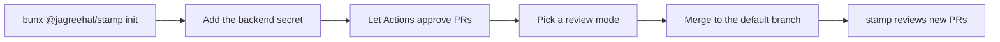

1. From the repository you want reviewed, run `bunx @jagreehal/stamp init --model <provider:model>` (add `--region <aws-region>` for Bedrock). It writes `.stamp/policy.yml`, `.stamp/review-guidance.md`, `.github/workflows/stamp.yml` and `.github/workflows/stamp-edited.yml` (and `stamp-digest.yml` with `--digest`), pinned to the stamp version you ran, then prints the secret your model needs and suggested CODEOWNERS entries for `.stamp/`, `.shepherd/` and `.github/`. It never overwrites a file that exists. To move existing workflows to a newer stamp, run `stamp init --upgrade`: it rewrites them from the new templates, keeps the environment, OIDC and region they were written with, and leaves the policy alone.
2. Add the secret for your backend. Prefer an environment secret: `stamp init --environment ai-review` puts the review job (and the digest job, with `--digest`) in that GitHub environment, so create the environment (no protection rules) and store the key there; no other workflow in the repository can then read it. Add your model provider's key as `STAMP_API_KEY` (see [Backends](/stamp/reference/backends/)), or `CLAUDE_CODE_OAUTH_TOKEN` (from `claude setup-token`) with `backends: [claude]` in `.stamp/policy.yml`. The secret is the only thing the workflow needs: the model and every other setting live in `.stamp/policy.yml` (`stamp init --model <id>` writes it), and `stamp config` shows what is in effect.
3. In Settings → Actions → General, turn on **Allow GitHub Actions to create and approve pull requests**. Without it stamp still posts the approval, but the approval does not satisfy a required-reviews rule.
4. Pick a **review mode**. Leave `STAMP_LABEL` unset to review every PR. Set `STAMP_LABEL: stamp` in the workflow env to review only PRs with that label.
5. Merge. stamp reads policy from the default branch, so it applies once it lands.

The workflow runs on open, push, reopen, ready-for-review, convert-to-draft, label and unlabel, and on a `/stamp` comment from anyone with write access (stamp checks the commenter's permission before it does anything else). `stamp-edited.yml` calls it on a base retarget, or when the author edits the review agent's disclosure section into the body, so other description edits add no `stamp / review` run.

The workflow pins the engine version, and pins `oven-sh/setup-bun` to a commit SHA because the job holds model keys. The engine decides what gets approved, so a version bump should arrive as its own PR.

Start with one repository, all-PRs mode, and a spend cap on the key.
