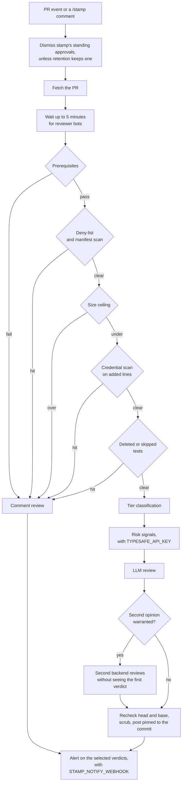

The gates decide first. The LLM can tighten a gate's result and can never loosen it. Every gate runs, so a refusal lists each one that failed.

The `tests` gate holds a PR that deletes a test file, or renames one so the runner skips it (out of a test path, off its `.test.` name, or to an extension no runner collects), or adds a marker that switches a test off or narrows a run to one: any `.skip` or `.only` access (`test.skip(`, `.only.each`, `test["skip"]`), `xit`, `fit(`, `fdescribe(`, `mark.skip`, `mark.xfail`, `skipTest(`, `t.Skip(`, `#[ignore]`, `@Disabled`, `@Ignore`. It reads the code on added lines in test files, with quoted strings, `//` and `/* */` comments, and Python `#` comments left out. Anything else it cannot read as prose counts. It also reads `#[ignore]` in any Rust file and `@Disabled` or `@Ignore` in any JVM file, since Rust keeps unit tests beside the code. A green run with a test skipped hides what that test covered, so a person decides. Conditional skips (`skipIf`, `runIf`, `mark.skipif`, `#[cfg_attr(..., ignore)]`), `test.todo`, and markers it read as prose reach the reviewer as a `test_markers` scrutiny flag. Rewritten assertions stay with the reviewer.

The `telemetry` gate holds a PR that writes a credential or a whole request into a log or span. It reads added lines in JavaScript and TypeScript source, tests aside, that call a span (`setAttribute`, `setAttributes`, `addEvent`) or a logger (`log`, `logger`, `console`, or a name ending in `Log`, `Logger` or `Span`, through `info`, `warn`, `error`, `debug`, `trace`, `fatal`, `log`, `set` or `child`). The call fails the gate when it carries a field named `password`, `secret`, `authorization`, `cookie`, `api_key`, `private_key`, an access, refresh, id or session token, a card number, `cvv`, `cvc` or `ssn`, as an object key or a span attribute name; or a whole `req.headers`, `req.body`, `req.cookies` or `c.req.header()`. A word in a log message, a longer name such as `passwordReset`, and one field such as `req.headers['x-request-id']` pass. Telemetry is copied to vendors and kept for weeks, so a leak there is not undone by rotating a key. Redact or drop the field; the observability rule pack covers personal data the gate cannot recognise by name.

## Prerequisites

- The PR is out of draft and has no merge conflicts.
- No "changes requested" review stands. A later comment does not clear one.
- The author is OWNER, MEMBER or COLLABORATOR, or has write access some other way (a team grant, or a private org membership that GitHub reports as CONTRIBUTOR), and the head lives on this repository, not a fork.
- The author is not a bot.

## The review

The reviewer reads files and searches the checkout, and does nothing else. It receives the diff, description, reviews, inline and discussion comments and reactions inside an untrusted-content fence. stamp leaves its own prior reviews out. The reviewer reads test hunks first and reports showstoppers only.

When HEAD is another commit, or the tree is dirty, stamp reviews from a detached worktree at the PR head.
