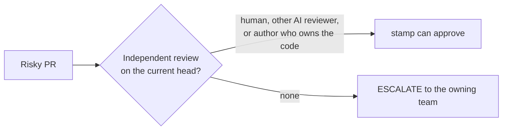

With a `CODEOWNERS` on the default branch (`.github/`, root or `docs/`), stamp tells the reviewer who owns each changed file and whether the author is a listed owner. That stays advisory and never gates.

An author who owns what they touched counts as assurance in risky territory; a cross-team author does not, and an ESCALATE names the owning team in its next step. stamp cannot resolve team handles (`@org/team`) to members without an org read the Actions token lacks, so it reports membership as unknown and a teammate's review becomes the assurance path.

In risky territory stamp will not approve on its own reading. It needs an APPROVED or substantive COMMENTED review from a person or a different AI reviewer on the current head.

List your other reviewer bots under `reviewer_bots` in `policy.yml` so stamp waits for their 👀 before it approves. A 👀 younger than 45 minutes holds the review for up to five minutes; their comments join the prompt when they post. Nothing re-triggers the workflow when a bot finishes, so a run that waited forever would never post a verdict. stamp ignores an older 👀 as a crashed reviewer. Review services that report as a check run go under `reviewer_checks`: the bundled policy lists `Claude Code Review`, and stamp holds the same five minutes while that check run on the head is queued or in progress. The workflows grant `checks: read` for it.

The `github-actions[bot]` approval counts toward required approving reviews once the Actions setting above is on. It does not satisfy "require review from Code Owners", and it should not: that rule exists so a person on the owning team looks, and stamp escalates to that person.

Copy `.agents/skills/` (`writing-pr-descriptions`, `merging-prs`, `pr`) into repositories where agents open PRs, or install them with `npx skills add jagreehal/stamp`. `pr` is [Matt Pocock's skill](https://github.com/mattpocock/skills), copied unchanged; `writing-pr-descriptions` uses its Merge Danger section and visuals.

When a PR closes issues in its own repository, stamp passes their title and body to the reviewer inside the untrusted fence. It skips issues in other repositories, which can be private while the PR is public. The reviewer checks the diff does what they ask: a change that does the opposite of its issue is a showstopper, and a vague issue never refuses a PR on its own.

## Review automation

stamp reads review threads with their resolution and includes unresolved threads in the review context. It reads an agent's "Changes made during review" disclosure as a separate section, and reviews the current head after the author updates that disclosure.

stamp includes review-agent commit trailers as context. The reviewer checks the diff against the stated intent and the test evidence in the PR body.
