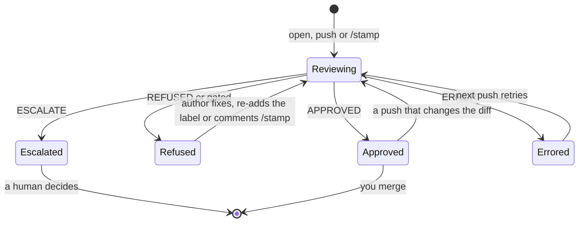

A repository either reviews every PR or waits for its trigger label. The engine returns one of four verdicts, and `--post` puts it on the PR.

| Verdict  | Where it lands                              | Trigger label in label mode |
| -------- | ------------------------------------------- | --------------------------- |
| APPROVED | A real GitHub review by the stamp login     | Kept                        |
| REFUSED  | A GitHub comment review by the stamp login  | Removed                     |
| ESCALATE | A GitHub comment review by the stamp login  | Removed                     |
| ERROR    | A GitHub comment review by the stamp login  | Kept, retries               |
| Gated    | A GitHub comment review by the stamp login  | Removed                     |

"Gated" means a deterministic gate, such as the deny-list or the size ceiling, denied the PR before any review. The engine reports it as `REFUSED` and removes the trigger label, because a person has to take it from there.

stamp posts an approval as a real review, once, pinned to the reviewed commit, carrying the review body, so it counts toward branch protection. It posts every other verdict once per run as a comment review on the same surface. The bot never requests changes.

The trigger label exists only in label mode, and only a substantive non-approval removes it. The author re-applies the label once they address the feedback. A verdict that says nothing about the PR keeps the label, and the next push retries.

`ERROR` means the run failed before it could judge the PR: the model backend was unreachable, a `STAMP_GUARD` limit stopped the review, or the reviewer returned something other than a verdict.

Set `STAMP_NOTIFY_WEBHOOK` to hear about refusals, escalations and errors as they land. Read [notifications](/stamp/integrations/notifications/).

An approval names the one fact the change is safe because of, under **Safe because**, with how far the reviewer checked it: `claimed` (it believes it), `cited` (it read the `file:line`), `traced` (it walked the failure path and it cannot reach) or `tested` (a test or story in the evidence exercises it). A high-risk approval that names no fact, or only a claimed one, becomes `ESCALATE`, because a belief is not assurance. The fact also lands in the evidence bundle, so you can audit what an approval rested on when it turns out wrong.

Every review shows the merge risk under the verdict and numbers its issues, so a reply can name one. Each issue opens with `file:line` and a title, and a bug names the input, the actual and expected result, and the fix. stamp refuses a bug it can show on an ordinary input, a change that brings back a problem a resolved thread named, and a new test the bug in the same diff passes.

Each non-approval carries a collapsed **Fix with a coding agent** block. It holds the verdict, the issues and the requested next step as one prompt you can copy, with the rule that weakening a test or a lint rule to clear the review counts as a refusal. Agents write most of the PRs stamp sees, so the fix loop starts there.

Comment `/stamp` on a PR to re-run the review without an empty commit. stamp acts on comments from people with write access only: OWNER, MEMBER and COLLABORATOR, or anyone the permission API says can push, which covers access through a team and private org members.

In CI the stamp login is `github-actions[bot]`. A local `--post` uses the account `gh` is logged in as. Each run can write an evidence bundle (`--json`), and the workflow uploads it as an artifact.
