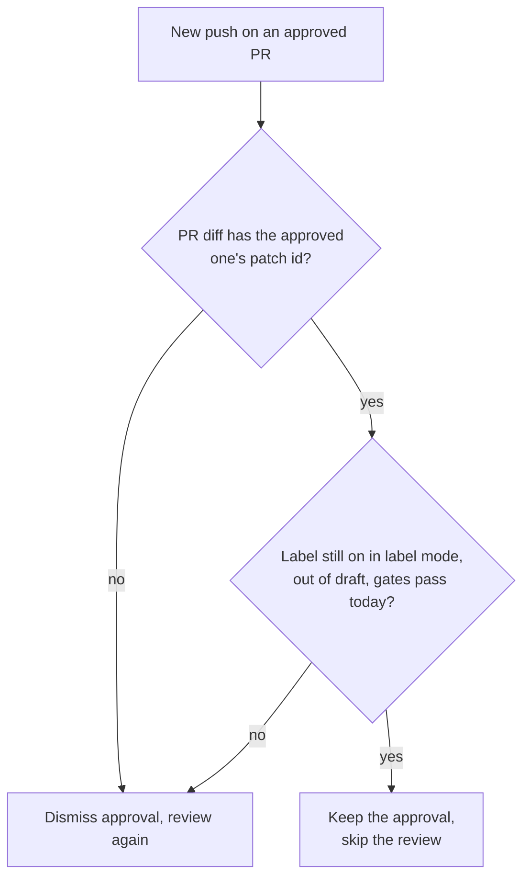

A push that leaves the PR's change the same as the approved one, usually a base-branch merge, keeps the standing approval and skips re-review. "The same" means the same `git patch-id --verbatim`: a base merge that shifts the PR's hunks, or edits a file the PR touches outside them, changes the diff's line numbers and blob ids but not the patch id. Whitespace still counts, since indentation is code in some languages. The new head's CI still runs. stamp keeps it only while the trigger label stays on, the PR stays out of draft, every gate passes against today's policy, and the PR still matches what stamp checked. Empty diffs, binaries or compare errors send the PR down the normal dismiss-and-review path. A `/stamp` comment starts a fresh review.
