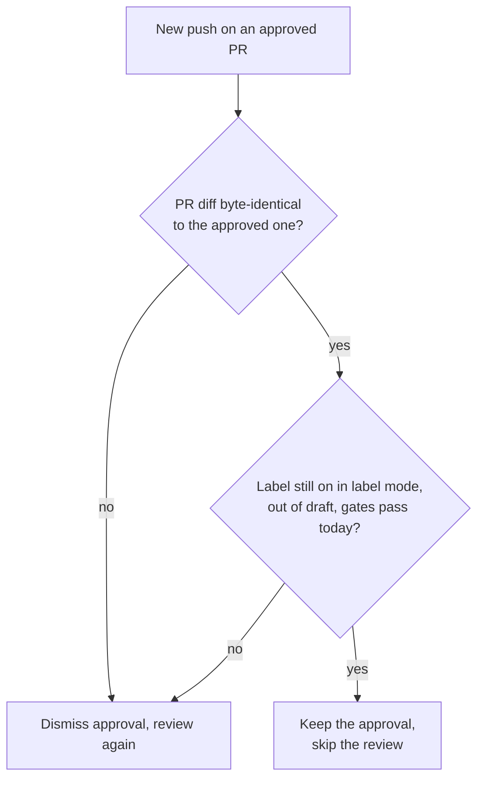

A push that leaves the PR's unified diff byte-identical to the approved one, usually a base-branch merge, keeps the standing approval and skips re-review. stamp keeps it only while the trigger label stays on, the PR stays out of draft, every gate passes against today's policy, and the PR still matches what stamp checked. Empty diffs, binaries or compare errors send the PR down the normal dismiss-and-review path. A `/stamp` comment starts a fresh review.
