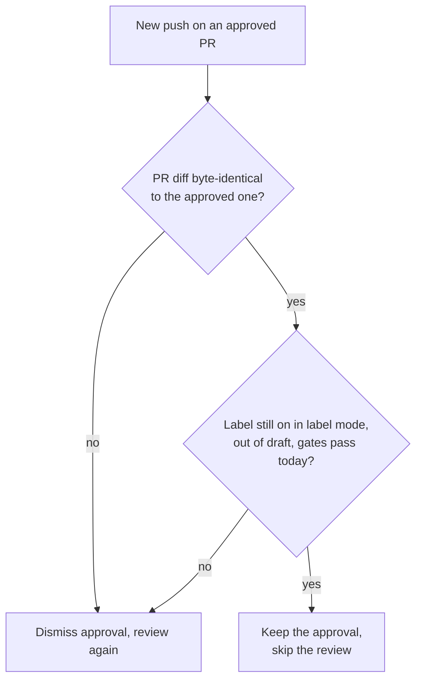

A push that leaves the PR's unified diff byte-identical to the approved one keeps the standing approval and skips re-review. That covers a base merge that touched none of the PR's files. A base merge that edits a file the PR touches sends the PR back for review, since the base edit can change what the PR's code does. The new head's CI still runs. stamp keeps it only while the trigger label stays on, the PR stays out of draft, every gate passes against today's policy, and the PR still matches what stamp checked. Empty diffs, binaries or compare errors send the PR down the normal dismiss-and-review path. A `/stamp` comment starts a fresh review.
