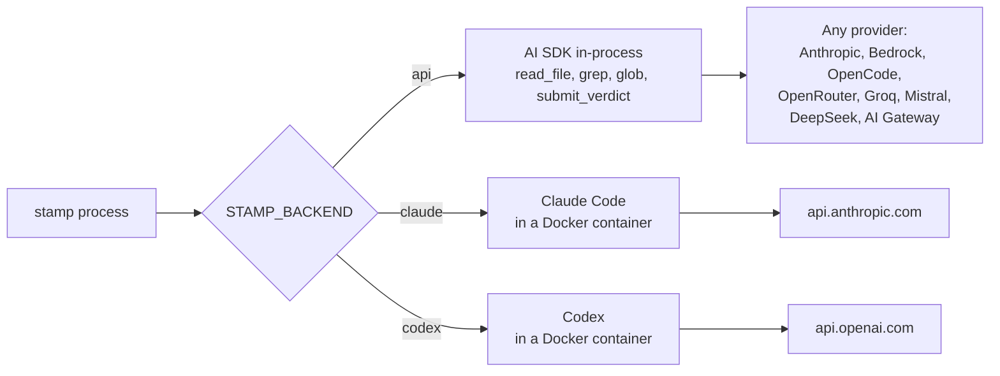
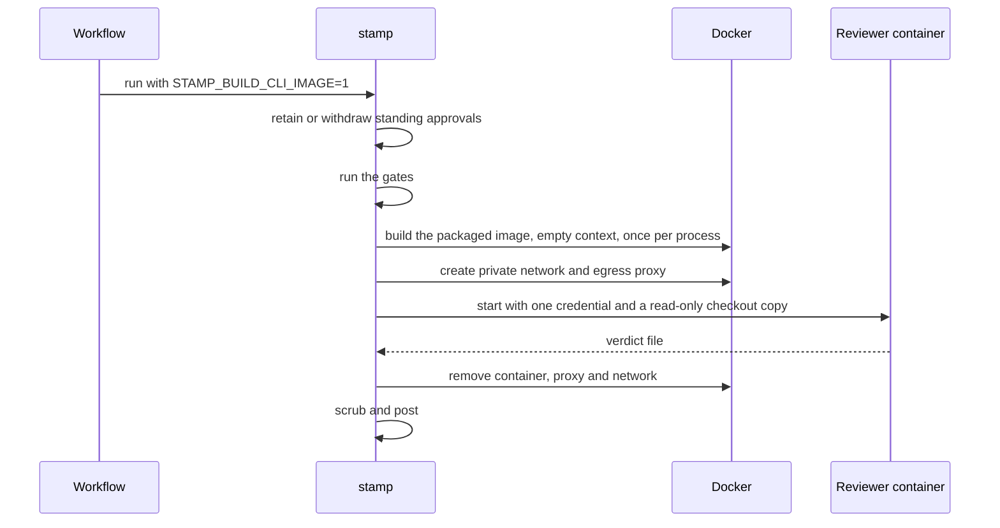
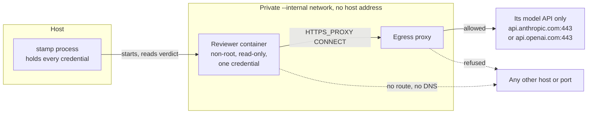
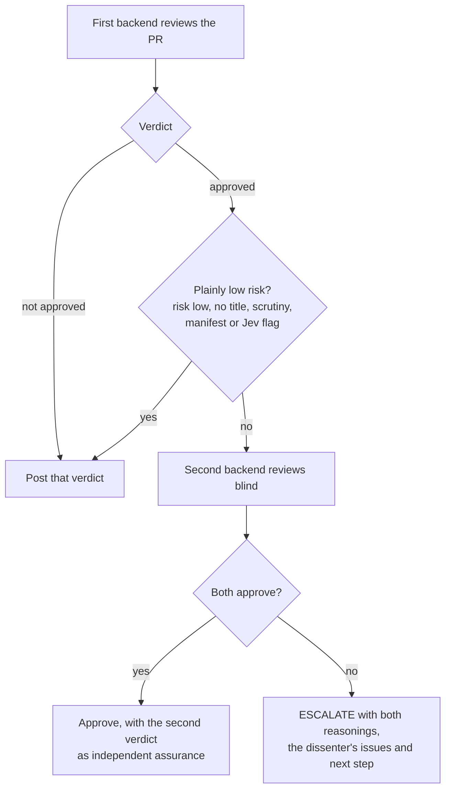

`STAMP_BACKEND` decides who runs the model. The prompt, the gates and the verdict schema stay the same.

| `STAMP_BACKEND` | Runs the review through | Auth | Model |
| --------------- | ----------------------- | ---- | ----- |
| `api` (default) | The AI SDK, on any provider below | `STAMP_API_KEY`, or that provider's own key | `STAMP_MODEL`, default `claude-opus-5` |
| `claude`        | Claude Code, headless (`claude -p`) | `CLAUDE_CODE_OAUTH_TOKEN` from `claude setup-token`, in an isolated container | `STAMP_CLAUDE_MODEL`, default Claude Code's |
| `codex`         | Codex, headless (`codex exec`) | `CODEX_API_KEY` or `OPENAI_API_KEY`, in an isolated container | `STAMP_CODEX_MODEL`, default Codex's |



`STAMP_MODEL` is `provider:model`, or a bare Claude id for Anthropic. An unknown prefix is read as part of an Anthropic model id. The `api` backend gives the model three tools confined to the checkout, `read_file`, `grep` and `glob`, and the model ends by calling `submit_verdict`.

One secret covers every provider: put the key in `STAMP_API_KEY` and Stamp sends it to whichever provider `STAMP_MODEL` names. The provider's own variable in the table below is the fallback when `STAMP_API_KEY` is unset. Bedrock ignores `STAMP_API_KEY` and uses its own credentials.

Set `STAMP_MODEL` and `STAMP_BACKEND` as repository variables, not secrets. GitHub masks a secret's value everywhere in the logs, so a secret `STAMP_BACKEND=api` would turn every "api" in the log into `***`.

| `STAMP_MODEL` | Provider | Key |
| ------------- | -------- | --- |
| `claude-opus-5` (no prefix) | Anthropic, or any endpoint in `ANTHROPIC_BASE_URL` | `STAMP_API_KEY` or `ANTHROPIC_API_KEY` |
| `bedrock:zai.glm-4.7-flash`, `bedrock:us.anthropic.claude-sonnet-5-5` | Amazon Bedrock (Claude through InvokeModel, the rest through Converse) | `AWS_BEARER_TOKEN_BEDROCK`, or any AWS credentials (OIDC, `AWS_PROFILE`, SSO, an instance role), and `AWS_REGION`; never `STAMP_API_KEY` |
| `opencode-go:kimi-k3`, `opencode:claude-sonnet-5-5` | OpenCode Go and Zen | `STAMP_API_KEY` or `OPENCODE_API_KEY` |
| `openrouter:moonshotai/kimi-k3` | OpenRouter | `STAMP_API_KEY` or `OPENROUTER_API_KEY` |
| `groq:openai/gpt-oss-120b` | Groq | `STAMP_API_KEY` or `GROQ_API_KEY` |
| `mistral:mistral-small-latest` | Mistral | `STAMP_API_KEY` or `MISTRAL_API_KEY` |
| `deepseek:deepseek-flash` | DeepSeek (OpenAI-compatible, `api.deepseek.com`) | `STAMP_API_KEY` or `DEEPSEEK_API_KEY` |
| `gateway:anthropic/claude-sonnet-5.5` | Vercel AI Gateway | `STAMP_API_KEY` or `AI_GATEWAY_API_KEY` |

```bash
STAMP_MODEL=deepseek:deepseek-flash   STAMP_API_KEY=...
STAMP_MODEL=claude-opus-5                       ANTHROPIC_API_KEY=sk-ant-...
STAMP_MODEL=bedrock:zai.glm-4.7-flash           AWS_BEARER_TOKEN_BEDROCK=...  AWS_REGION=eu-west-1
STAMP_MODEL=opencode-go:deepseek-v4-flash       OPENCODE_API_KEY=...
STAMP_MODEL=openrouter:moonshotai/kimi-k3       OPENROUTER_API_KEY=...
STAMP_MODEL=groq:openai/gpt-oss-120b            GROQ_API_KEY=...
STAMP_MODEL=mistral:mistral-small-latest        MISTRAL_API_KEY=...
STAMP_BACKEND=claude                            # CLAUDE_CODE_OAUTH_TOKEN required
STAMP_BACKEND=codex                             # CODEX_API_KEY or OPENAI_API_KEY required
```

## Isolated CLI reviewers

`claude` and `codex` run in Docker containers. Docker must be running. stamp builds a trusted reviewer image from the packaged `templates/reviewer.Dockerfile`, never from the PR checkout.



The generated workflow sets `STAMP_BUILD_CLI_IMAGE=1`. stamp handles approval retention or withdrawal, runs the gates, then builds the packaged image with an empty build context before it calls a CLI reviewer. Add the image setting and `CODEX_API_KEY` or `OPENAI_API_KEY` to existing workflows.

For local use, set `STAMP_BUILD_CLI_IMAGE=1`, or build from a trusted stamp checkout with an empty context:

```bash
review_context="$(mktemp -d)"
docker build -f templates/reviewer.Dockerfile -t stamp-reviewer:local "$review_context"
```

`STAMP_CLI_IMAGE` selects another trusted image; prefer a digest for a published image. A missing Docker daemon, image or backend credential ends the review as ERROR, with no fallback to a host CLI. stamp never mounts host login files. Claude uses `CLAUDE_CODE_OAUTH_TOKEN` (from `claude setup-token`). Codex uses `CODEX_API_KEY` or `OPENAI_API_KEY`, which stamp passes to `codex exec` as `CODEX_API_KEY`.



The container has its own process namespace, so `/proc` cannot expose stamp's environment. It receives its own backend credential, a read-only checkout copy without `.git`, trusted review instructions and an empty output directory, and nothing more. It runs as a non-root user with capabilities dropped and privilege escalation disabled. stamp never mounts host homes, Docker sockets or credential directories, and treats container output as untrusted, verdict-file symlinks included.

Each review gets a private Docker network with no route out, on which the host has no address. An egress proxy, started from the same image, is its one door: it tunnels `CONNECT` to the reviewer's model API, only when the TLS ClientHello inside the tunnel names that same host, and refuses everything else. The name check stops a tunnel to the provider's address from reaching another site on the same CDN. Claude reaches `api.anthropic.com:443`, Codex reaches `api.openai.com:443`. The reviewer reaches the proxy through `HTTPS_PROXY`; a request that skips it has no route and no DNS. The proxy logs each decision.

Codex runs `danger-full-access` because nested Linux sandboxing needs privileges this container does not grant. The container is the boundary: a read-only checkout and filesystem, writable storage limited to temporary state and the verdict, and a network path to its own provider only. A command Codex runs can reach that provider and nothing else. The provider's API can fetch a URL it receives, such as an image input, so a hijacked review could route data out through the provider, and the proxy sees encrypted traffic it cannot inspect. Use a dedicated key with a spend limit, and choose the `api` backend, which has no shell, where that matters.

stamp redacts configured credential values from posted reviews, console verdicts and evidence bundles, including CLI login tokens, provider keys and telemetry headers.

The `api` backend runs its repository-confined tools in-process and needs no Docker.

## Limits, cost and traces

Every `api` review runs under `STAMP_GUARD`, written in autotel's rule shorthand. The default is `budget:$2,tokens:3m,loop:4/12,max-tools:80,timeout:15m`: a cost ceiling, a token ceiling, a spin-loop rule (the same call 4 times in 12), a tool-call cap, and a timeout that also cuts off a model call in flight. A rule that fires ends the review as ERROR. A model without a price keeps its token ceiling; give it a price with `STAMP_PRICING='{"kimi-k3":{"inputPer1M":3,"outputPer1M":15}}'`.

The mechanics table names the model, its tool calls, the cost and the time (`bedrock:zai.glm-4.7-flash · 9 tool calls · $0.0042 · 6.2s`). The `--json` evidence carries the full run record: steps, tool calls and failures, tokens, cost and the limits it ran under. Set `OTEL_EXPORTER_OTLP_ENDPOINT` and each run also becomes a trace. One `stamp.review` span covers the run from start to verdict, and the `gen_ai.*` spans, one per model call and tool call, nest under it. Its attributes make one wide event per review, so you can chart approval rates, refusal reasons and ERROR runs by repository:

| Attribute | Holds |
| --- | --- |
| `stamp.verdict` | APPROVED, REFUSED, ESCALATE or ERROR; an ERROR run also marks the span failed |
| `vcs.repository.name`, `vcs.change.id`, `vcs.ref.head.revision` | the repository, the PR number and the reviewed head |
| `vcs.ref.base.revision`, `cicd.pipeline.run.id`, `stamp.ci.attempt` | the reviewed base and CI run/attempt, for correlation with Shepherd |
| `stamp.tier`, `stamp.gates.failed`, `stamp.denied` | the size tier, the gates that failed and the deny-list categories hit |
| `stamp.retention` | `kept` when a standing approval survived, otherwise why it was dismissed |
| `stamp.backends`, `stamp.risk`, `stamp.second_opinion`, `stamp.cost_usd` | who reviewed, the reviewer's risk grade, the second verdict and the run's model cost |
| `stamp.cost_complete`, `stamp.reviewers`, `stamp.tool_calls`, `stamp.input_tokens`, `stamp.output_tokens` | whether all reviewer costs are known, how many reviewers ran, and their measured tool/token totals |
| `stamp.title_flags`, `stamp.scrutiny`, `stamp.signal_flags`, `stamp.familiarity` | the flags and familiarity band the reviewer was given |
| `stamp.egress.denied_host`, `stamp.egress.denied_name`, `stamp.egress.refused` | how many connections the egress proxy refused a CLI reviewer: to another host, with another TLS name, or from outside the review network |

Shepherd's gardener can read these spans from OTLP JSON/JSON-lines exports (`shepherd garden owner/repo --traces file.json`) or a read-only Grafana Tempo endpoint. It reports known review spend and unpriced reviews alongside stage timing and approval waits. `stamp.cost_usd` is the known subtotal; `stamp.cost_complete=false` means a reviewer was unpriced or the review failed before all usage was recorded. A gated or retained run with no model calls records zero cost. The gardener counts the root subtotal once, with the child model calls inside it, and these measurements leave Stamp's gates unchanged.

Without the variable, stamp loads no OpenTelemetry code. CLI reviews also print the proxy's refusal counts as `reviewer egress refused: ...` and keep them in the `--json` evidence under `llm.egress`. Stamp records counts, never the hosts or TLS names: the reviewer chooses those, so a hijacked one could encode a secret in them. A refused connection to another host can be a CLI's routine call home (Codex asks for `chatgpt.com`); one with another TLS name is a fronting attempt. The proxy's own log, which names each target, stays in the container and is removed with it.

The agent backends load nothing the PR ships as configuration. [AGENTS.md](https://github.com/jagreehal/stamp/blob/main/AGENTS.md) records how stamp isolates each one and what was tested.

On a comment-only diff, Claude Code grepped the source before approving. Codex on its default model approved from the diff alone. Set `STAMP_CODEX_MODEL` to a model that explores.

## Two reviewers

```bash
STAMP_BACKENDS=claude,codex
STAMP_BACKENDS=bedrock:zai.glm-4.7-flash,openrouter:moonshotai/kimi-k3   # two api models from different families
```




The first backend reviews every PR. The second runs when the first approves something above plain low risk: a risk above `low`, or a title, scrutiny, manifest or Jev flag. It never sees the first verdict.

When both approve, stamp approves and lists the second verdict in the mechanics table as the independent assurance risky territory asks for. When they disagree, stamp posts ESCALATE with both reasonings, the dissenter's issues and its next step. A plainly low-risk PR costs one call.

Across 146 real PRs, four commercial reviewers never flagged the same line, and 93% of findings came from one tool alone. Two models from different families miss different things.

## Risk signals

```bash
TYPESAFE_API_KEY=...
```

With a key, stamp asks [Jev](https://docs.typesafe.ai/concepts/system-one) ten yes/no questions about the diff before the reviewer runs. Does the change alter auth, billing, the data model or a public contract, CI or build tooling, dependencies or install scripts, a data write path? Does it feed user input into a prompt, weaken tests or CI config, or do something the description leaves out?

Jev answers each question with a calibrated probability and no prose, in a few hundred milliseconds, for a fraction of a cent. The probabilities go into the reviewer's trusted context, count as flags at 0.7 and above for the second-opinion trigger, and land in the evidence bundle. They never act as a gate and cannot loosen one. stamp tells the reviewer to treat a flag as a magnifying glass and a low probability as no assurance.

Path patterns cannot see behaviour. A PR titled "nicer export filenames" that also inserts an admin grant in `src/export.ts` matches no deny pattern; Jev gave it `undisclosed_behavior` 0.97, `auth` 0.95, `write_path` 0.88. A test-weakening diff scored `weakens_tests` 0.98; a comment-only diff scored 0.03 across the board.

Those are three calls, not a calibration. Tune the threshold against your evidence bundles and what you merged.
